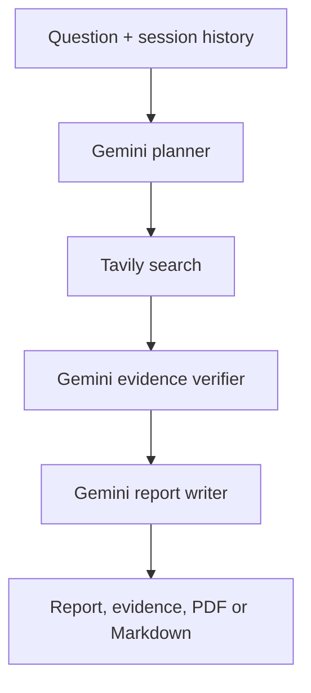

# AI Research & Intelligence Agent

🚀 **Live Demo:** [AI Research & Intelligence Agent](https://ai-research-intelligence-agent-vmhfday4gprhkwnkr8jgd5.streamlit.app/)

A Streamlit research assistant that turns a question into a documented research workflow. Gemini plans the search and assesses claims, Tavily finds web sources, and LangGraph coordinates the steps. Verified source passages are displayed alongside the claims they support, and reports can be downloaded as Markdown or PDF.

## Features

- LangGraph workflow with planner, web search, evidence verifier, and report writer nodes.
- Gemini-powered planning, verification, and report generation.
- Tavily web search with duplicate URL removal and stable source labels (`S1`, `S2`, ...).
- Claim-level evidence records with exact quote matching against collected source text. Quotes that do not appear in a source are removed and cannot support a claim.
- Conversation history and follow-up context retained for the current Streamlit browser session.
- PDF and Markdown report downloads, including a linked source list in PDF.
- Automated tests for evidence validation, malformed model output, rate-limit retries, duplicate sources, empty search results, workflow orchestration, PDF output, and the Streamlit UI.
- A 25-case synthetic claim-verification benchmark with status accuracy, macro F1, and evidence quote coverage metrics.
- GitHub Actions checks on Python 3.11 and 3.12.

## macOS setup

1. Install Python 3.10 or newer if needed. In Terminal, go to the project directory:
   ```bash
   cd /path/to/PythonProject8
   ```
2. Create and activate a virtual environment:
   ```bash
   python3 -m venv .venv
   source .venv/bin/activate
   ```
3. Install dependencies:
   ```bash
   python -m pip install --upgrade pip
   python -m pip install -r requirements.txt
   ```
4. Create a Gemini key in [Google AI Studio](https://aistudio.google.com/app/apikey) and a Tavily key at [Tavily](https://app.tavily.com/).
5. Create your local settings file and open it:
   ```bash
   cp .env.example .env
   open -e .env
   ```
   Replace the placeholder values for `GEMINI_API_KEY` and `TAVILY_API_KEY`. The default model is `gemini-3.5-flash-lite`. Gemini free-tier availability and limits depend on the model and can change; see Google's [Gemini API pricing](https://ai.google.dev/gemini-api/docs/pricing).
6. Start the app:
   ```bash
   streamlit run app.py
   ```
   Open the local URL printed in Terminal, usually `http://localhost:8501`.

## Deploy to Streamlit Community Cloud

1. Push this project to a GitHub repository. Do not add `.env` or `.streamlit/secrets.toml`; both are ignored by Git.
2. In Streamlit Community Cloud, create an app from that repository and select `app.py` as the main file.
3. Open the app's **Settings → Secrets** and add the entries shown in `.streamlit/secrets.toml.example`, replacing the placeholders with your keys.
4. Deploy, open the app URL, and submit a research question. The app reads hosted secrets first when local environment values are absent.

The same code also works on hosts that provide environment variables. Set `GEMINI_API_KEY`, `GEMINI_MODEL`, and `TAVILY_API_KEY` in the host's secret/environment settings.

## Run checks

With the virtual environment active:

```bash
python -m unittest discover -s tests -v
```

The tests do not call Gemini or Tavily. Check the benchmark data without API calls:

```bash
python scripts/evaluate.py
```

Run a small live benchmark sample (three Gemini requests):

```bash
python scripts/evaluate.py --live --limit 3 --output reports/evaluation.json
```

Retest a single labeled case with `--case-id CASE-21` after changing verifier prompts.

The full benchmark makes 25 Gemini requests. The script waits between requests to reduce rate-limit errors; live evaluations use your Gemini API quota. Macro F1 averages the labels present in the run; `macro_f1_all_labels` also includes labels absent from a limited sample. The cases use fictional source text, so this benchmark measures claim classification and quote handling on controlled examples. It does not measure real-world factual accuracy or prove source reliability. Run the benchmark before publishing any performance numbers.

To try live research, enter a question in the app; Gemini and Tavily requests use their respective API quotas.

Run one compact live end-to-end check from Terminal:

```bash
python scripts/smoke_live.py
```

This makes Gemini and Tavily requests and prints only a pass/fail summary.

## Architecture



Evidence checks confirm that the cited quotation appears in the retrieved Tavily text. They do not independently confirm that the source itself is accurate or trustworthy. Conversation history is stored in Streamlit session state and is cleared when the session ends.

## Demo walkthrough

1. Ask: “What are the reported benefits and limitations of heat pumps in cold climates?”
2. Show the generated research plan and source labels.
3. Open **Evidence assessment** and compare a claim’s quote with its linked source.
4. Download the report as PDF and show the linked source list.
5. Ask a follow-up in the same browser session to demonstrate conversation context.
